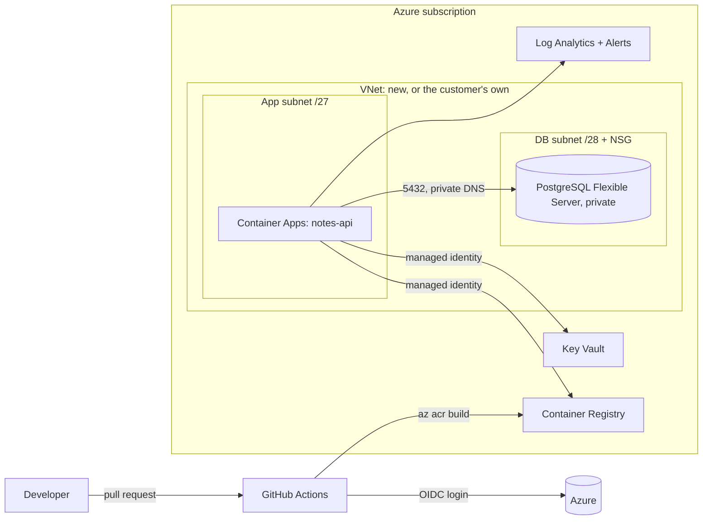

# Notes API: Private-Network Deployment on Azure

A small web service deployed into a private Azure Virtual Network (Azure's version of a VPC) with
Terraform and GitHub Actions. It can create its own network, or deploy **into a network a customer
already owns**, which is how vendors install enterprise software inside customer cloud environments.

## What it shows

- **Infrastructure as code:** everything is Terraform, with remote state in Azure Storage.
- **Customer-network deployments:** one variable switches between "create a VNet" and "deploy
  into the customer's VNet". In customer mode, Terraform only adds two subnets to their network.
- **Private by default:** PostgreSQL has no public endpoint. The database subnet only accepts
  traffic from the app subnet. In customer mode, the app itself is reachable only inside the VNet.
- **No stored passwords:** GitHub logs in to Azure with OpenID Connect. The app pulls images and
  reads its database connection string from Key Vault with a managed identity.
- **CI/CD:** tests, lint, `terraform validate`, a security scan, a plan comment on every pull
  request, two-pass deploys, smoke tests, and a one-command rollback.
- **Operations:** health and readiness probes, autoscaling on request load, central logs in
  Log Analytics, and alerts for 5xx errors and crash loops.

## Architecture



## Repository layout

```
app/                    FastAPI service, tests, Dockerfile
infra/                  Terraform (network, database, registry, Key Vault, app, monitoring)
infra/environments/     dev.tfvars (own VNet, public) and contoso.tfvars (customer VNet, private)
scripts/                bootstrap, deploy, smoke test, rollback, simulated customer network
.github/workflows/      ci.yml, deploy.yml, destroy.yml
docs/runbook.md         troubleshooting and operations
```

## What you need to do

### 1. Get the tools and accounts (about 30 minutes)

1. Create an Azure account at azure.microsoft.com/free. New accounts get a credit for the first
   30 days; after that, you pay as you go.
2. **Set a budget alert first:** in the Azure portal, open Cost Management > Budgets and create a
   $25 monthly budget with an email alert.
3. Install the [Azure CLI](https://learn.microsoft.com/cli/azure/install-azure-cli), plus
   [Terraform](https://developer.hashicorp.com/terraform/install) and the GitHub CLI. On a Mac:
   `brew install azure-cli terraform gh`.
4. Sign in: `az login` and `gh auth login`.

### 2. Put the code on GitHub

```bash
cd azure-vnet-platform
git init && git add . && git commit -m "Initial commit"
gh repo create azure-vnet-platform --public --source . --push
```

### 3. Run the one-time bootstrap

```bash
./scripts/bootstrap.sh <your-github-username>/azure-vnet-platform
```

This creates the Terraform state storage and the identity GitHub Actions uses, then prints five
values. Save them as repository secrets with the `gh secret set` commands it prints. Optionally,
add `ALERT_EMAIL`.

### 4. Create the GitHub environments

In the repo, open **Settings > Environments** and create `dev` and `contoso`. On `contoso`, add
yourself as a required reviewer, so customer deploys wait for approval like they would at a real
company.

### 5. Deploy

Push to `main` (or run **Actions > Deploy > Run workflow > dev**). The pipeline:

1. creates the network, registry, database and secrets
2. builds the image in Azure Container Registry
3. deploys the app
4. smoke-tests it

The run summary shows the URL. Open `<url>/docs` to try the API.

### 6. Practice a customer deployment

```bash
./scripts/create-customer-vnet.sh      # plays the customer's IT team creating their network
```

Then run **Actions > Deploy > contoso**. The app lands inside `vnet-contoso-corp` and is
reachable only from that network.

### 7. Practice operations

- **Break and fix:** set the readiness path to a bad value, deploy, and watch the smoke test fail
  and the bad revision stay out of service. Then roll back with
  `./scripts/rollback.sh dev <previous-sha>`.
- **Load test:** run `hey -z 60s -c 100 <url>/api/notes` and watch replicas scale out under
  Container App > Metrics.
- **Read logs:** in Log Analytics, run
  `ContainerAppConsoleLogs_CL | order by TimeGenerated desc`.

### 8. Tear it down when you're not using it

Run **Actions > Destroy** (type the environment name to confirm). Deleting the Terraform state
storage is optional; it costs pennies.

## Cost

Running 24/7, `dev` is roughly $25–40 a month. Most of that is PostgreSQL B1ms, plus the
container app with one always-on replica, the Basic registry, and logs. Destroy it between
practice sessions and it's a few dollars. To cut costs further, set `min_replicas = 0` so the
app scales to zero when idle.

## Run it locally

```bash
docker compose up --build     # API on http://localhost:8000/docs with a local Postgres
cd app && pip install -r requirements-dev.txt && pytest
```

## Production hardening, next steps

- Private endpoints for Key Vault and the registry, plus a self-hosted runner inside the VNet.
- An Azure Firewall or NAT Gateway for controlled outbound traffic.
- Entra ID login to PostgreSQL instead of a password.
- A Helm/AKS version of the same deployment for customers who run Kubernetes.
- Database migrations with Alembic as a separate pipeline step.
